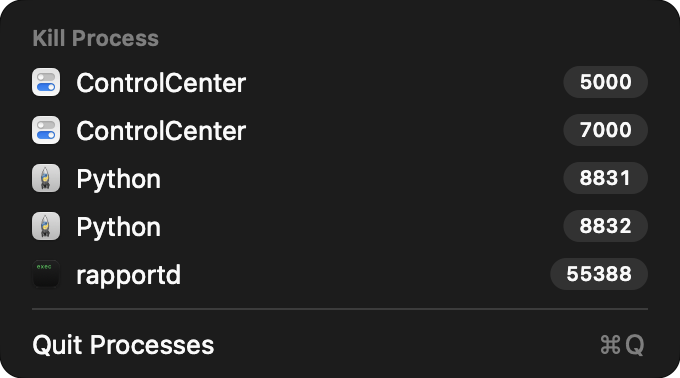

# Processes

A macOS menu bar app that shows which of your processes are listening on which TCP ports, and kills one with a click.

## Usage

Click the plug icon in the menu bar. Every listening port gets its own row, with the process's icon, its name and the port number.

- **Click a row** to terminate that process (`SIGTERM`).
- **Hold Option** to turn each row into Force Kill, for a process that won't quit (`SIGKILL`).

The list is rescanned each time the menu opens. There is no confirmation step: the process is signalled as soon as you click.

## Requirements

- macOS 27 or later
- Xcode 27 to build

## Building

There are no prebuilt releases, so build it from source:

1. Clone the repository and open `Processes.xcodeproj` in Xcode.
2. Select the Processes target, open Signing & Capabilities, and choose your own team.
3. Run the Processes scheme.

The app has no Dock icon and no window. Look for the plug icon in the menu bar, and quit it with Quit Processes in its menu.

## How it works

- Listening ports are read straight from the system with `libproc`. The app doesn't shell out to `lsof` or `netstat`.
- The menu is a SwiftUI `MenuBarExtra`, shown as a native menu.
- Nothing runs in the background. There are no timers and no polling, only a scan when the menu opens.
- The app makes no network connections and has no third-party dependencies.

## Limitations

- Only your own processes are listed. Ports held by root or by other users don't appear.
- Only listening TCP ports are shown, not UDP.
- A server that forks workers gets one row per process, and its port stays in use until all of them are gone.
- `SIGTERM` ends an app without giving it the chance to ask about unsaved changes.
- The app isn't sandboxed, because the App Sandbox blocks inspecting and signalling other processes. That rules out the Mac App Store.

## License

MIT. See [LICENSE](LICENSE).
